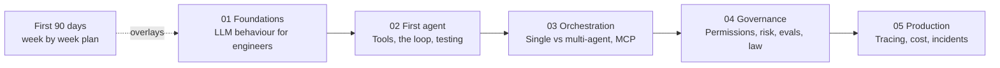

# Agentic Engineer Path

An onboarding path for software engineers joining an agentic AI team.

I run engineering teams that build agentic AI platforms. Every time a new engineer joins, I walk them through the same material in the same order. This repository is that material, published in the open so anyone can use it.

This is a curriculum, with a sequence and exercises. The order matters. The exercises matter more than the reading.

## Who this is for

Working software engineers who are new to agents. You can already ship production code, review a pull request, and debug a distributed system. You may never have called an LLM API. That is fine. That is the person this path was written for.

It is not an introduction to programming, and it is not a machine learning course. You will not train models here. You will build systems that use them.

## How to use it

Work through the stages in order. Each stage has a few short explainers, a read and watch list, and one to three exercises. Do the exercises. Reading about agents gives you opinions. Building them gives you judgement. The exercises are not optional.

If you are onboarding onto a team, pair the stages with the [first 90 days plan](stages/first-90-days.md). It maps the stages onto a week by week schedule with concrete things to build and demo.

## The roadmap

| Stage | File | What you can do afterwards |
|---|---|---|
| 01 | [Foundations](stages/01-foundations.md) | Reason about tokens, context, temperature, structured outputs, and failure modes |
| 02 | [First agent](stages/02-first-agent.md) | Build a tool-using agent loop and test it deterministically |
| 03 | [Orchestration](stages/03-orchestration.md) | Choose between single and multi-agent designs, pick a framework, integrate over MCP |
| 04 | [Governance](stages/04-governance.md) | Scope permissions, tier risk, gate releases with evals, know the UK and EU rules |
| 05 | [Production](stages/05-production.md) | Trace, budget, and run agent systems, and respond when they fail |
| Plan | [First 90 days](stages/first-90-days.md) | Know what to build, read, and demo at weeks 1, 2, 4, 8, and 12 |

## Exercises and reference repos

Several exercises use small open source projects I maintain, so you work against real code rather than toy snippets:

- [llm-gateway](https://github.com/mindfulcto-labs/llm-gateway): multi-provider LLM routing with cost policies and observability
- [sre-copilot](https://github.com/mindfulcto-labs/sre-copilot): an incident triage assistant with runbooks
- [confighub](https://github.com/mindfulcto-labs/confighub): schema-validated configuration management
- [agent-governance-kit](https://github.com/mindfulcto-labs/agent-governance-kit): audit trails and governance controls for agents

For further reading beyond the stages, see [aidlc](https://github.com/mindfulcto-labs/aidlc) on AI-assisted development lifecycles and [agentic-harness](https://github.com/mindfulcto-labs/agentic-harness) on harness engineering.

## Status

Status: v0.1.0, single-maintainer, opinions are the author's. Links are checked in CI, so if one dies you will see a failing badge before you see a dead page. Suggestions are welcome through issues. See [CONTRIBUTING.md](CONTRIBUTING.md) for the quality bar.

## Licence

[CC BY 4.0](LICENSE). Use it, adapt it for your own team, credit the source.
